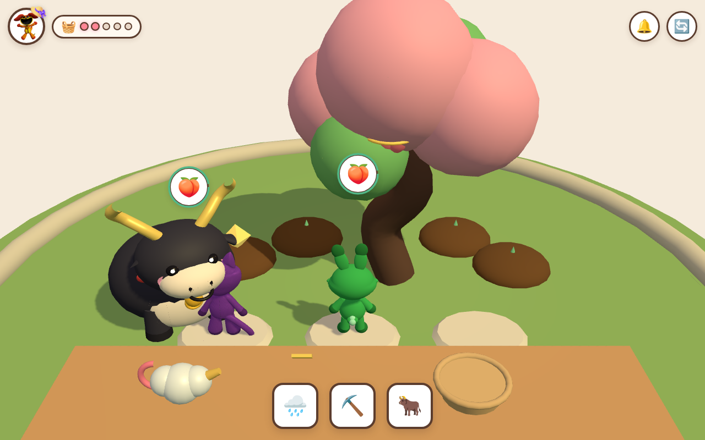

# Critter Peach Garden 3D: Magic Hoe & Cloud Ox!

> 100% Zero-Text, Zero-Voiceover 3D Three.js Cozy Garden Web Game for 5-Year-Old Players  
> Inspired by 《开局长生万古，苟到天荒地老》 (Chen Xun & Big Black Ox)  
> Live URL: [https://kunruiw1991.github.io/critters-peachgarden3d/](https://kunruiw1991.github.io/critters-peachgarden3d/)

## 🌸 Gameplay Highlights

- **100% Zero-Text & Pure ASMR WebAudio (`alphaHanziCount === 0`)**:
  - Strictly zero English or Chinese text anywhere on the screen or `<canvas>`.
  - Zero robotic text-to-speech voiceovers; pure tactile ASMR SFX (pitter-patter water droplets, earthy hoe thuds, crisp peach pops, juicy chewing bites, and warm ox lowing marimba chords).
- **3D Cloud Ox Companion (祥云大黑牛)**:
  - Chubby charcoal-indigo plush ox with curved golden cloud horns, red braided collar, and 3D golden bell.
  - Feeding him ripe peaches triggers squishy chewing cheeks, ear wiggles, rainbow heart puffs, bonus coins (`+15`), and a garden patience boost.
- **Ancient Bonsai Peach Tree & Magic Cloud Watering Pot**:
  - Twisted ancient trunk with blooming peach-blossom foliage clouds and 4 hanging peaches.
  - Dragging or tapping the 3D Cloud Watering Can waters buds, swelling them into glowing golden-rose peaches with rotating gold halo rings.
  - Tapping or dragging ripe peaches harvests them into the woven bamboo basket.
- **4 Soil Mounds & Ancient Relic Digging**:
  - 1:1 Draggable Golden Hoe tills loam mounds with flying soil clod physics, unearthing 4 ancient relics:
    - ☀️ **Star Rune Stone** (golden octahedron)
    - 🌙 **Moon Jade Ruyi** (curved emerald scepter)
    - 💎 **Ruby Crystal Gourd** (crimson calabash)
    - 🍀 **Lucky Copper Coin** (four-leaf coin with square core)
- **8 Visiting Smiling Critters**:
  - `DogDay`, `CatNap`, `Hoppy`, `CraftyCorn`, `Bubba`, `Picky`, `Kickin`, and `Bobby` visit garden stepping stones with visual thought bubbles showing their desired gift.
  - Satisfying their orders rewards coins and star medals.
- **Seasons / Waves Progression**:
  - **Wave 1: Spring Blossom Orchard** (pastel pink cherry blossom drift, warm sun).
  - **Wave 2: Twilight Glade** (dusk purple-blue skies, floating stone lanterns, glowing fireflies).
  - **Wave 3: Imperial Starlight Sanctuary** (celestial cosmic nebula, floating starlight crystals, golden peach aura).
- **Strict Monotonic 5-Critter Olympic Podium**:
  - `1st: 60% (192px)` > `2nd: 47% (150px)` > `3rd: 36% (115px)` > `4th: 26% (83px)` > `5th: 17% (54px)`.
  - Player Gardener crowned on 1st Place with Gold Crown + Straw Farmer Hat; Baba Chops in 4th/5th slot.

---
